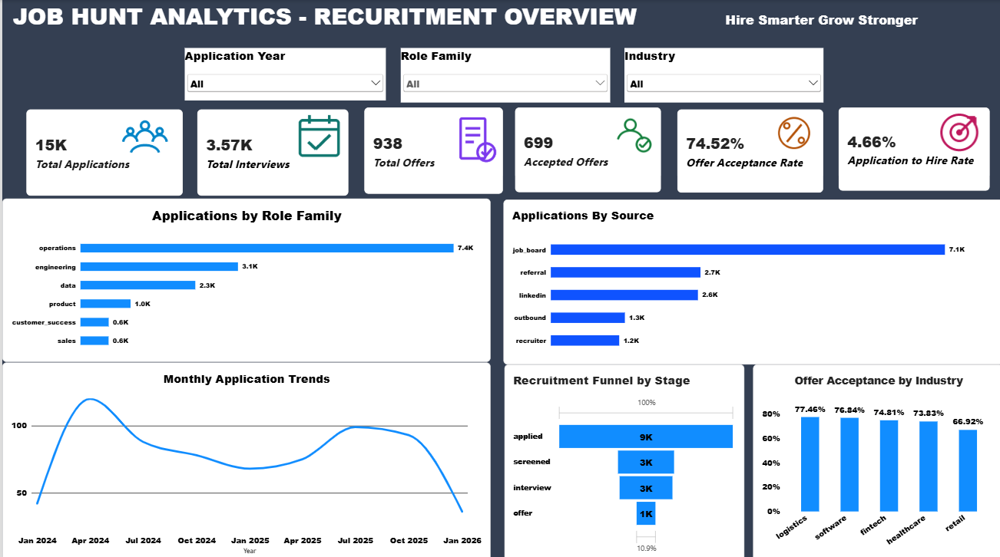

# Job Hunt Analytics – Recruitment Funnel Dashboard

## Project Overview

Job Hunt Analytics is an end-to-end data analytics project that examines recruitment performance across the application-to-offer process.

The project analyzes application sources, recruitment stages, interview outcomes, offer acceptance, industry performance, and salary trends to identify useful recruitment insights.

**Note:** This project uses a synthetic recruitment dataset for portfolio and analytical practice. It does not represent real candidate or company records.

## Business Objectives

- Analyze the recruitment application funnel.
- Identify application sources generating the most applications.
- Measure application-to-interview and application-to-offer conversion.
- Evaluate interview round performance.
- Analyze offer acceptance across industries.
- Compare offered salaries across role families.
- Build an interactive recruitment performance dashboard.

## Tools and Technologies

| Tool | Purpose |
|---|---|
| Python | Data cleaning, transformation and analysis |
| Pandas | Data manipulation and analysis |
| PostgreSQL | SQL querying and business analysis |
| Power BI | Interactive dashboard and visualization |
| GitHub | Project documentation and version control |

## Dataset

The project uses six synthetic CSV datasets:

- Applications
- Candidates
- Companies
- Jobs
- Interviews
- Offers

The datasets were obtained from the Hugging Face dataset:

`mindweave/job-postings-applications`

**License:** CC BY-NC 4.0 (Attribution-NonCommercial 4.0 International).

The data is synthetic and is used for non-commercial portfolio and learning purposes. Refer to the original dataset page for its terms and attribution requirements.

## Project Workflow

1. Loaded and explored the recruitment datasets using Python.
2. Checked missing values and duplicate records.
3. Converted application dates and extracted year and month.
4. Analyzed recruitment stages and application sources.
5. Merged the datasets while preserving one row per application.
6. Summarized interview activity and analyzed interview outcomes.
7. Calculated offer acceptance and recruitment conversion rates.
8. Imported the prepared data into PostgreSQL for SQL analysis.
9. Built an interactive Power BI dashboard.

## Power BI Dashboard

The interactive dashboard provides insights into recruitment performance, including application sources, recruitment stages, interview outcomes, offer acceptance, and role-family analysis.

### Dashboard Preview



**Dashboard File:** [job_hunt_analytics_dashboard.pbix](powerbi/job_hunt_analytics_dashboard.pbix)

## Key Performance Indicators

| Metric | Result |
|---|---:|
| Total Applications | 15,000 |
| Applications with Interviews | 3,570 |
| Total Offers | 938 |
| Accepted Offers | 699 |
| Application-to-Interview Rate | 23.80% |
| Application-to-Offer Rate | 6.25% |
| Offer Acceptance Rate | 74.52% |
| Application-to-Hire Rate | 4.66% |

## Key Insights

- Job boards generated the highest application volume, with 7,094 applications.
- Fintech recorded the highest offer conversion rate at 7.02%.
- Data roles had the highest average offered salary in the dataset.
- The overall offer acceptance rate was 74.52%.
- August 2025 recorded the highest monthly application volume, with 855 applications.

## Repository Structure

```text
job_hunt_analytics/
│
├── data/
│   ├── applications.csv
│   ├── candidates.csv
│   ├── companies.csv
│   ├── interviews.csv
│   ├── jobs.csv
│   ├── offers.csv
│   └── final_recruitment_data.csv
│
├── data_analysis.py
├── job_hunt_Analytics_Dashboard.pbix
├── README.md
└── recruitment_analysis.sql
```

## How to Run the Project

### Python

Install the required libraries:

```bash
pip install pandas
```

Download the six CSV files from the original dataset source and place them in the same folder as the Python script.

Run:

```bash
python data_analysis.py
```

### SQL

Import the prepared application data into PostgreSQL and run the queries in:

`recruitment_analysis.sql`

The SQL analysis uses PostgreSQL features including:

- Common Table Expressions (CTEs)
- Window functions
- DENSE_RANK()
- ROW_NUMBER()
- LAG()
- Aggregate functions
- Conditional aggregation with FILTER

### Power BI

Open the `.pbix` dashboard file using Microsoft Power BI Desktop.

## Project Limitations

- The dataset is synthetic and may not reflect real-world recruitment behavior.
- Salary units and currency are not specified in the source data.
- Application stages represent recorded current stages, not necessarily every historical transition.
- Interview records can contain multiple interviews for one application.

## Author

**Ayush Kumar**

**Data Analytics Portfolio Project**

Tools: Python | SQL | PostgreSQL | Power BI
